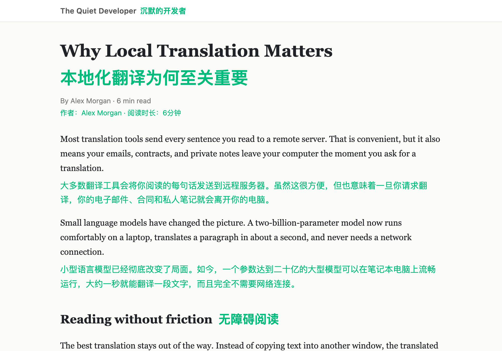
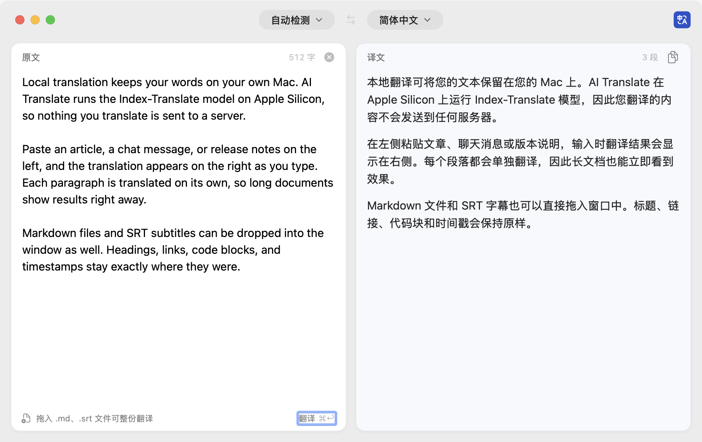
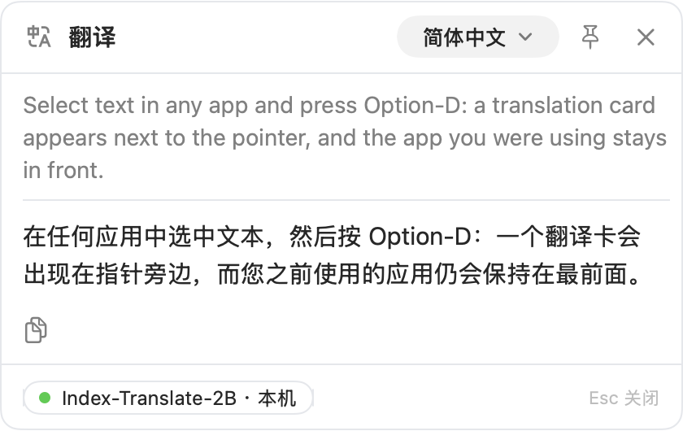
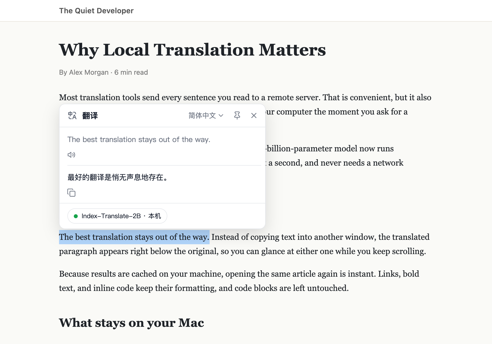
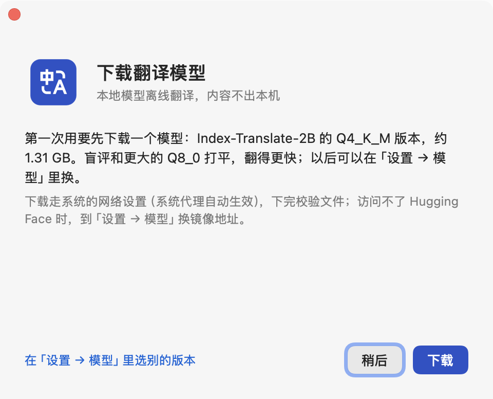
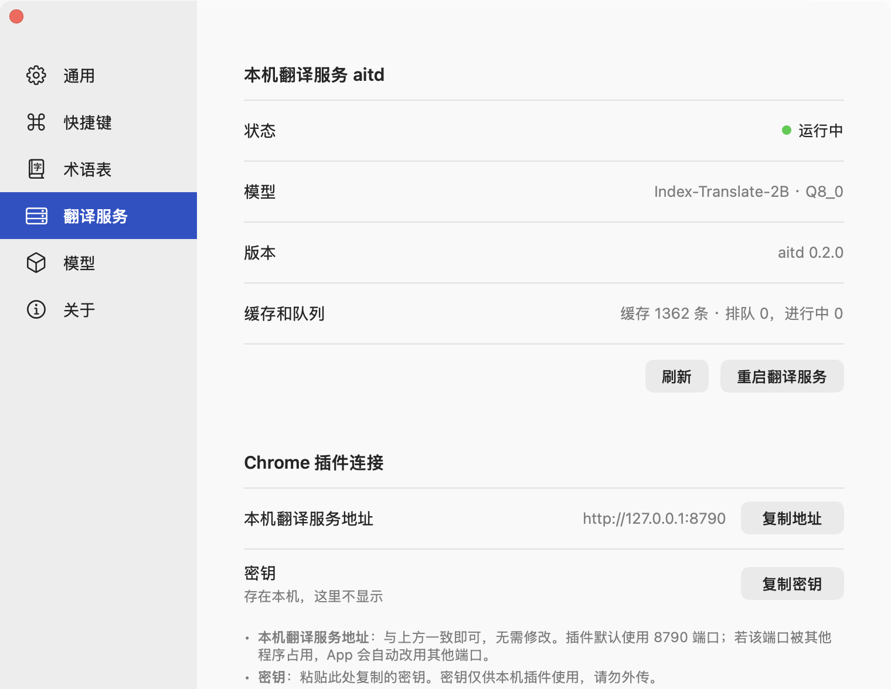
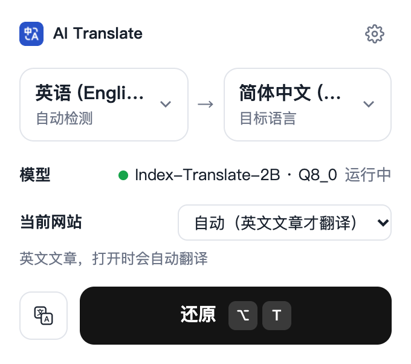

  

<h1 align="center">AI Translate</h1>

<a href="https://github.com/ListenerGao/ai-translate/releases/latest"><strong>下载</strong></a> &nbsp;·&nbsp; <a href="#快速上手">快速上手</a> &nbsp;·&nbsp; <a href="#日常使用">使用说明</a> &nbsp;·&nbsp; <a href="#常见问题">常见问题</a> &nbsp;·&nbsp; <a href="docs/development.md">技术说明</a> &nbsp;·&nbsp; <a href="ROADMAP.md">进度</a>

  
  
  
  
  

 

<strong>开源 · MIT · 模型跑在你的 Mac 上，翻译内容不出本机</strong>

<h3 align="center">Mac 上的本地离线翻译：网页、划词、文字、文档和字幕都能翻。</h3>

桌面应用在本机运行翻译模型，任何 App 里选中文字就能翻；Chrome 插件边滑动边翻译英文网页。不注册、不限次数，断网也能用。第一次用，从桌面应用开始。

维护者：<strong>ListenerGao</strong>。

> [!IMPORTANT]
> 需要 **Apple 芯片**（M1 及以后）的 Mac，系统 **macOS 14 或更高**。App 没有做付费的苹果公证，第一次打开时系统会拦一下，到「系统设置 → 隐私与安全性」点「仍要打开」即可，见[安装](#安装)。

 

## 它是什么

AI Translate 是一个本地离线翻译工具：用本机运行的 Index-Translate 模型翻译网页、文字、Markdown 文档和字幕，翻译内容不出本机。

它由两部分组成：**桌面应用**（macOS）负责在本机运行翻译模型，并提供划词翻译、翻译窗口和文件翻译；**Chrome 插件**（可选）负责翻译网页。默认翻成简体中文，也能翻成英语、日语、韩语、法语、德语、西班牙语等。只有第一次下载模型时需要联网。

## 你能得到什么

- **翻译不出本机**：模型跑在你的 Mac 上，网页、划词、文件的内容都不会发到任何服务器；不用注册账号，没有次数限制。
- **网页边看边翻**：打开英文文章自动翻译，译文显示在每段原文下方，往下滑接着翻；可以切换「双语对照」和「只看译文」。
- **哪里都能划词**：网页里选中文字点图标；备忘录、微信、PDF 等任何 App 里选中文字按 `⌥D`。
- **整份翻文档和字幕**：把 Markdown（`.md`）或字幕（`.srt`）拖进翻译窗口，译文保存在原文件旁边，格式和时间轴不变。
- **术语统一**：把常用词的固定译法写进术语表，比如 `prompt=提示词`，网页、划词、文件翻译都照着用。

## 看看效果

**Chrome 插件：网页双语翻译**（译文显示在原文下方，边滑动边翻译）

**桌面应用：翻译窗口**（按 `⌥A` 打开，左边粘贴原文，右边边输入边出译文）

**桌面应用：划词翻译**（在任何 App 里选中文字按 `⌥D`，鼠标旁边弹出译文）

**Chrome 插件：网页里划词翻译**（选中文字，点旁边的「中→A」图标）

## 快速上手

下载、打开、下载模型，就能用。第一次用，从桌面应用开始。

1. 从 [Releases 页面](https://github.com/ListenerGao/ai-translate/releases/latest)下载 `AI-Translate-<版本>-macos-arm64.zip`，解压后把 `AI Translate.app` 拖进「应用程序」，再从那里打开。
2. 系统提示「无法验证开发者」时，到「系统设置 → 隐私与安全性」点「仍要打开」。
3. 按引导下载模型（约 1.3 GB），菜单栏出现「中→A」图标就能用了。
4. 按 `⌥A` 打开翻译窗口，或在任何 App 里选中文字按 `⌥D`。

想翻译网页的话，再装上 Chrome 插件，见[第二步：Chrome 插件](#第二步chrome-插件可选)。每一步的详细说明见[安装](#安装)。

## 三种用法

- **桌面应用**：常驻菜单栏，任何 App 里划词翻译（`⌥D`）、打开翻译窗口（`⌥A`）、整份翻译 Markdown 和字幕。第一次用从这里开始。
- **Chrome 插件**：英文文章自动翻译，双语对照或只看译文；网页里划词翻译和朗读。
- **命令行**：在「设置 → 通用」里安装后，在终端里用 `ait "Hello world"` 翻译文字，`ait translate 文章.md` 翻译文件，用法见[技术说明](docs/development.md#命令行-ait)。

三种用法背后是同一个本机翻译服务，术语表和翻译缓存都共用。下面是详细的安装和使用说明。

## 安装

### 安装前准备

| 需要 | 说明 |
|---|---|
| Mac | **Apple 芯片**（M1、M2、M3、M4 等），系统 **macOS 14 或更高**。Intel 芯片的 Mac 不能用 |
| 磁盘 | 至少 **2 GB** 空闲：模型约 1.3 GB |
| 内存 | 运行时约占 2 GB，见常见问题「占多少内存」 |
| 网络 | 第一次下载模型时能上网（要访问 Hugging Face；访问不了也可以换镜像，见[常见问题](#常见问题)） |
| 浏览器 | 想翻译网页的话，需要 **Chrome 浏览器**（120 或更高版本） |

### 第一步：桌面应用

1. **下载安装包**：打开 [Releases 页面](https://github.com/ListenerGao/ai-translate/releases/latest)，在下方的 Assets 里下载 `AI-Translate-<版本>-macos-arm64.zip`。想自己从源码构建的，看[技术说明](docs/development.md)
2. **解压**：双击 zip，得到一个文件夹，里面有 `AI Translate.app`、`Chrome 插件` 文件夹和 `使用说明.txt`
3. **拖进「应用程序」**：把 `AI Translate.app` 拖进访达左侧的「应用程序」，再从「应用程序」里双击打开。不要直接在「下载」文件夹里打开，App 会提示你先拖进去
4. **允许打开**：第一次打开时，系统会提示「无法验证开发者」（这个 App 没有做付费的苹果公证，不是有问题）。先关掉这个提示（不要点「移到废纸篓」），然后打开「系统设置 → 隐私与安全性」，往下翻到「安全性」，找到 AI Translate，点「仍要打开」，再确认一次。以后就不会再拦
5. **下载模型**：App 第一次打开会弹出引导，点「下载」。下载约 1.3 GB，完成后自动校验、自动用上；可以关掉窗口，下载会在后台继续

   

6. **完成**：屏幕右上角的菜单栏出现「中→A」图标，就可以用了。按 `⌥A` 试试翻译窗口

### 第二步：Chrome 插件（可选）

只想用划词和翻译窗口的话，可以跳过这一步。

1. **放好插件文件夹**：把解压出来的 `Chrome 插件` 文件夹移到一个不会被删的地方，比如「文稿」。Chrome 每次启动都从这里读，删了插件就没了
2. **加载插件**：在 Chrome 地址栏输入 `chrome://extensions` 回车，打开右上角的「开发者模式」，点「加载已解压的扩展程序」，选中 `Chrome 插件` 文件夹
3. **固定到工具栏**：点 Chrome 右上角的拼图图标，在 AI Translate 旁边点图钉，工具栏就会出现「中→A」图标
4. **复制密钥**：打开 AI Translate 的设置（点菜单栏「中→A」图标 →「设置…」），选「翻译服务」，在「Chrome 插件连接」里点「复制密钥」

   

5. **填进插件**：点工具栏的「中→A」图标，再点弹窗右上角的齿轮打开插件设置。把密钥粘贴到「密钥」，点「保存」，再点「测试连接」，看到「连接正常」就好了。「本机翻译服务地址」和 App 里显示的一样就不用改

> [!NOTE]
> 插件靠桌面应用工作：AI Translate 开着，插件才能翻译。退出 App 后，插件会提示你打开它。

## 日常使用

### 翻译网页

- 打开英文文章会**自动翻译**，译文显示在每段原文下方，往下滑接着翻
- 没有自动翻的页面：点工具栏的「中→A」图标，再点「翻译」，或者按 `⌥T`。再按一次恢复原样
- 只想看译文：按 `⌥⇧M`，或者点弹窗里「翻译」左边的小按钮，在「双语对照」和「只看译文」之间切换
- 某个网站想一直翻译或从不翻译：在弹窗的「当前网站」里选

### 划词翻译

- **网页里**：选中文字，旁边出现一条小工具条，点「中→A」看译文，点喇叭朗读原文（用 Mac 自带的语音，不联网）
- **任何 App 里**：选中文字按 `⌥D`，鼠标旁边弹出译文卡片。第一次按时会提示打开「辅助功能」权限，按提示在「系统设置 → 隐私与安全性 → 辅助功能」里打开 AI Translate 就行，不用重启
- 卡片上可以复制译文、临时换目标语言、点图钉固定；按 `Esc` 关闭

### 翻译窗口

- 按 `⌥A`，或点菜单栏「中→A」图标 →「打开翻译窗口」
- 左边粘贴或输入原文，停顿一下右边就出译文；右上角的按钮复制全部译文
- 顶部可以选原文语言和目标语言

### 翻译文件

- 把 `.md`、`.srt` 文件拖进翻译窗口（或按 `⌘O` 选文件），确认后点「开始翻译」
- 译文保存在原文件旁边，文件名加上语言，比如 `文章.md` 翻成 `文章.zh.md`；打开「双语」开关可以保留原文
- 文件要是 UTF-8 编码，单个不超过 900 KB

### 术语表

- 在 App 的「设置 → 术语表」里，一行写一条「原文=译文」，比如 `mockup=原型图`，点「保存」
- 网页、划词、翻译窗口、文件翻译都会用这份术语表

### 其他设置

- **换模型**：「设置 → 模型」里可以下载、切换别的版本。一般用默认推荐的就好
- **开机自动打开**：「设置 → 通用」里的「登录时自动打开 AI Translate」
- **改快捷键**：「设置 → 快捷键」
- **命令行**（会用终端的话）：「设置 → 通用」里点「安装」，就能在终端里用 `ait "Hello world"` 翻译，用法见[技术说明](docs/development.md#命令行-ait)

## 快捷键

| 快捷键 | 作用 | 在哪里 |
|---|---|---|
| `⌥A` | 打开翻译窗口 | 任何 App |
| `⌥D` | 翻译选中的文字 | 任何 App |
| `⌥T` | 翻译当前网页 / 恢复原样 | Chrome |
| `⌥⇧M` | 切换双语对照 / 只看译文 | Chrome |
| `⌘O` | 翻译文件 | AI Translate 里 |
| `⌘,` | 打开设置 | AI Translate 里 |

`⌥` 是 Option 键，`⇧` 是 Shift 键，`⌘` 是 Command 键。`⌥A`、`⌥D` 可以在「设置 → 快捷键」里改，`⌥T`、`⌥⇧M` 在 Chrome 的 `chrome://extensions/shortcuts` 里改。

## 常见问题

- **打开 App 时提示「无法验证开发者」**：见「第一步：桌面应用」第 4 条，到「系统设置 → 隐私与安全性」点「仍要打开」。macOS 15 起，右键「打开」不能再绕过这一步
- **提示「先把 AI Translate 拖进应用程序文件夹」**：你是直接在「下载」里打开的。把它拖进「应用程序」，从那里打开
- **模型下载失败或很慢**：打开「设置 → 模型」，把下方的「下载地址」换成镜像 `https://hf-mirror.com`，点「应用」后重新下载；中断了点「继续下载」会接着下
- **占多少内存**：用默认的 Q4_K_M 模型，桌面应用和插件全开着约 2 GB；翻译时只多约 0.1 GB，翻完回落（0.2.0 实测）
  - 模型文件读进内存的部分：约 1.2 GB。活动监视器把它算在「已缓存文件」里，不算在下面的进程名下
  - 翻译模型（`llama-server` 进程）：0.45～0.6 GB
  - 本机翻译服务（`aitd` 进程）：约 60 MB
  - 桌面应用：30～50 MB
  - Chrome 插件：后台约 30 MB；每个正在翻译的网页多 10～20 MB
  - 换成 Q8_0 模型的话，模型文件那部分是 1.8 GB，合计约 2.5 GB
  - App 开着时模型一直留在内存里，随时能翻；退出 App 就全部释放
- **插件提示「本机翻译服务没启动」**：先确认 AI Translate 开着，菜单栏能看到「中→A」图标。开着还是不行的话，到 App 的「设置 → 翻译服务」看「本机翻译服务地址」，如果不是 `http://127.0.0.1:8790`（8790 端口被别的程序占了，App 会自动换一个），点「复制地址」粘贴到插件设置里
- **插件提示「密钥不对」或「还没填密钥」**：按「第二步：Chrome 插件」第 4、5 条重新复制、粘贴密钥
- **某个网页不翻译**：
  - Chrome 自己的页面（`chrome://` 开头）、应用商店等，插件按规定不能运行
  - 刚装好插件时，已经打开的网页要刷新一下
  - 不像文章的页面（首页、搜索结果、列表）不会自动翻，可以按 `⌥T` 手动翻
- **按 `⌥D` 没反应**：先确认真的选中了文字；再看「设置 → 快捷键」，`⌥D` 旁边有红色提示说明被别的 App 占了，换一个组合键；辅助功能显示没打开的话，点「打开系统设置」。实在不行，按 `⌥A` 打开翻译窗口粘贴进去翻
- **在 VS Code 里没选中文字按 `⌥D`，翻出来的是一整行**：VS Code 没选中文字时复制的是光标所在的整行，先选中再按
- **剪贴板工具（Paste、Maccy 等）里多出一条记录**：在 Chrome、微信这类 App 里划词时，要模拟一次复制才能拿到文字，剪贴板工具会记下这一条；剪贴板本身取完就恢复原样
- **在输入框里按 `⌥D` 打不出「∂」**：`⌥D` 被划词占用了。经常要打这个符号的话，在「设置 → 快捷键」里换一个组合键
- **退出 App 后插件不能用了**：正常现象，翻译服务由 App 启动。打开 App，插件会自动接着翻

## 更新和卸载

**更新**：退出 AI Translate（点菜单栏「中→A」图标 →「退出 AI Translate」），用新安装包里的 App 替换「应用程序」里的旧 App，再打开。模型、设置、术语表和密钥都会保留。用插件的话，把 `Chrome 插件` 文件夹也换成新的，再到 `chrome://extensions` 点 AI Translate 的刷新按钮。

**卸载**：

1. 在「设置 → 通用」里关掉「登录时自动打开 AI Translate」，然后退出 App
2. 把「应用程序」里的 AI Translate 拖到废纸篓
3. 在 `chrome://extensions` 里移除 AI Translate 插件，再删掉 `Chrome 插件` 文件夹
4. 想把模型和数据一起删掉的话，在访达里按 `⇧⌘G`，输入 `~/Library/Application Support/ai-translate` 前往，把这个文件夹删掉（里面有模型、术语表和翻译缓存）
5. 装过命令行的话，再删掉 `~/.local/bin/ait`

## 隐私

- 网页、划词、窗口和文件的翻译都在你的 Mac 上完成，不发送到任何服务器，也不接入任何在线翻译服务
- 插件和 App 只连本机地址（`127.0.0.1`），网页里的脚本连不上翻译服务
- 唯一的联网是下载模型（Hugging Face 或你填的镜像），只下载模型文件，不带任何翻译内容
- 不保存翻译历史；日志只记录事件、耗时和错误，不记原文、译文和密钥

## 特性

写给想了解原理的进阶用户。

- **模型在本机跑**：翻译模型是 Index-Translate-2B 的量化版本，由 llama.cpp 的 `llama-server` 用 Apple 芯片的 GPU 运行。新手引导推荐 Q4_K_M（1.3 GB），盲评和 Q8_0 打平、速度快约两成；也可以在「设置 → 模型」里换成 Q8_0。
- **一个本机服务，三端共用**：插件、桌面应用和命令行都只连本机翻译服务 `aitd`，缓存、术语表和排队调度都在这里。划词和网页翻译优先，批量的文件翻译最多占模型 4 路里的 3 路，留 1 路给前面这些。
- **开箱即用**：App 里自带 Node 22、`aitd` 和 `llama-server`，不用另装 Node、llama.cpp 或 Xcode。8790 端口被占时，App 依次试 8791～8799，上次用的端口优先。
- **只在本机通信**：`aitd` 只监听 `127.0.0.1`，除健康检查外都要带密钥，拒绝网页发来的请求；插件和 App 也只接受本机地址。
- **边滑动边翻译**：插件只翻屏幕内和下方一屏的段落，还没开始翻就滑出范围的会撤销，滑回来再翻，不浪费模型算力。

## 文档

- **使用**：[安装](#安装) · [日常使用](#日常使用) · [快捷键](#快捷键) · [常见问题](#常见问题) · [更新和卸载](#更新和卸载) · [隐私](#隐私)
- **技术说明**：[工作方式](docs/development.md#工作方式) · [从源码安装](docs/development.md#从源码安装) · [命令行 ait](docs/development.md#命令行-ait) · [本机翻译服务 aitd](docs/development.md#本机翻译服务-aitd) · [开发与打包](docs/development.md#开发) · [其他文档](docs/development.md#其他文档)
- **项目**：[进度与计划](ROADMAP.md) · [版本发布](https://github.com/ListenerGao/ai-translate/releases)

## 致谢

- [Index-Translate-2B](https://huggingface.co/IndexTeam/Index-Translate-2B)：翻译模型，模型文件来自 [IndexTeam/Index-Translate-2B-GGUF](https://huggingface.co/IndexTeam/Index-Translate-2B-GGUF)
- [llama.cpp](https://github.com/ggml-org/llama.cpp)：在 Mac 上运行模型的 `llama-server`

 

---

  代码以 MIT 许可证开源，见 <a href="LICENSE">LICENSE</a>
   
  模型不在本仓库里，Index-Translate-2B 的使用条款以它在 Hugging Face 上（<code>IndexTeam/Index-Translate-2B</code>）的说明为准

